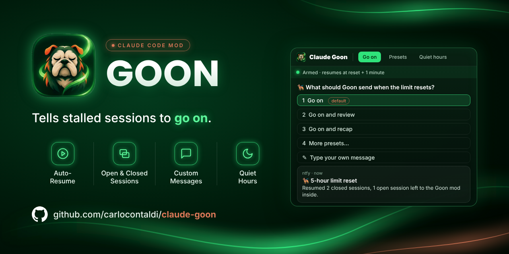

<h1 align="center">
  <br>
  Claude Goon
</h1>

> **goon** · /ɡuːn/ (*GOON*) · *noun*, plural *goons*
>
> A henchman: a person hired to do what another sends them to do.
>
> *Probably short for English dialect* gooney, *a simpleton. Here the name also runs together* go on.

<br>

A Claude Code plugin that tells interrupted sessions to go on. When a usage limit stops a session, Goon waits for the reset time the limit message states, then sends the session a resume message. The waiting costs no tokens; only the resumed turn does.

<p1 align="center">
  <br>
</p1>

Two halves share the work, so a session is brought back whether or not its window is still open:

- **Open sessions.** A mod inside the session notices the limit, arms a timer for the reset time plus a minute, and submits the resume message into the same session and panel. If the prompt box holds a draft at that moment, it waits and checks again every 30 seconds. A newer turn (you, or the built-in `/rate-limit-options` wait) cancels it. The resume time is stored, so a session reopened before then is re-armed.
- **Closed sessions.** The plugin's `classic.StopFailure` module hook (it acts on the `rate_limit` error) starts a detached watcher per reset time. At reset plus a minute it checks each interrupted session: still ending in the limit error, and no running Claude Code process holding it. Those it resumes headless, one every 15 seconds, with `claude --resume <id>` over stream-json, in the session's own directory. Sessions already continued are left alone, and so are open ones, which belong to the mod inside them.

The watcher then pushes one line to a private ntfy topic naming the limit, such as `5-hour limit reset: resumed 2 closed sessions, 1 open session left to the Goon mod inside.`

What a session is sent is yours to set: presets such as `Go on and recap`, a default for every session, and a message for each session on its own. See [Choose what is sent](#choose-what-is-sent) and [See what is waiting](#see-what-is-waiting).

Claude Code 2.1.319 also has a built-in wait (`/rate-limit-options`, "Wait here, then continue automatically"). It is per session, you choose it by hand each time, and the session has to stay open. Goon arms itself, and also covers sessions that were closed.

## Requirements

- Linux, macOS, or Windows (uses `fcntl.flock` on POSIX and `msvcrt.locking` on Windows; CI gates on Linux only, its Windows leg is informational), Python 3.9 or newer with the standard library only, and `claude` on the machine. The StopFailure hook is part of the plugin's module, so it runs no shell command and needs no particular shell; it and the slash commands run `python3`, or `python` when there is no working `python3`. Python on Windows has no time zone database: there, `pip install tzdata`; without it a reset stated in a named zone is not understood.
- To read whether a session is open, the watcher lists `~/.claude/sessions/*.json`, a registry Claude Code keeps but does not document. If it cannot be read, closed sessions are skipped and logged rather than guessed at.

## Install

At the prompt of a terminal session:

```
/plugin install goon --marketplace carlocontaldi/claude-goon
```

From a shell:

```
claude plugin install goon --marketplace carlocontaldi/claude-goon
```

A hook registered twice, for example by an old `hooks.StopFailure` entry for `goon.py` in `~/.claude/settings.json`, still does its work once: the script remembers each hook input for an hour and ignores a second delivery of it.

## Switch it on and off

Goon is on by default. In any session, `/goon off` stops it everywhere, `/goon on` starts it again and `/goon status` says which it is. The switch is the file `~/.claude/goon/off`, so it covers every open session and the closed-session watcher until you flip it back. It is read when Goon is about to resume something, so turning it on before a reset still resumes that session, and turning it off stops resumes that have not started. A resume already running is not stopped.

## Choose what is sent

Six presets are built in, in this order: `Go on`, `Go on and review`, `Go on and recap`, `Go on and wrap up`, `Go on, then review and recap` and `Go on, then review and wrap up`. `/goon presets` lists them with numbers. `/goon preset add <text>` adds one of your own and `/goon preset remove <number or text>` removes it again; yours are kept in `~/.claude/goon/presets.json`, and the built-in six cannot be removed.

Three levels decide the text, the most specific first:

1. The message chosen for one session.
2. The default message, set with `/goon message <number or text>`. It stays until `/goon message default`, so it also covers limits that happen later. `/goon message` alone shows it.
3. The *Resume message* option below, or `Go on` when that is empty.

A number picks that preset; any other text is sent as typed, up to 1,000 characters.

Goon reads the message when it is about to send it, not when it saw the limit. A change made while a reset is still hours away therefore applies to every session waiting for it. A resume that has already started keeps the message it started with.

When a limit stops a session that has the Goon mod loaded, the session asks what to send it. The question lists the presets with the default first, goes on to a second page (`More presets…`) when there are more than four (the six built-in ones already need it), and takes your own text in its free-text field. The question's chip and Goon's toasts start with 🐕‍🦺. Dismissing it keeps the default. Picking the default option also keeps it, and pins nothing, so a later change to the default still applies. The choice is kept for that session, whether it is still open at the reset or has been closed by then.

To change a session's choice later:

| Command | Effect |
|---|---|
| `/goon session <id> message <number or text>` | The session gets this message. |
| `/goon session <id> message default` | The session gets the default message again. |
| `/goon session <id> off` | Goon leaves the session alone at the reset. `on` undoes it. |
| `/goon session <id> reset` | Drops both choices. |

`<id>` is the first four or more characters of the session id, as `/goon list` shows it. Typed in a session, `this` stands for that session's own id. A session's choices last for that interruption: Goon drops them once it has handled or continued the session, and at the session's next limit stop.

## See what is waiting

`/goon list` shows the interrupted sessions Goon will continue, soonest reset first:

```
2 interrupted sessions waiting. Goon is on; it sends "Go on, then review and recap" unless a session has its own message.

9c04d7aa  Review the pricing page
  open, /home/dev/web (feature/pricing), 0.8 MB, $2.10 so far, claude-sonnet-5-5
  5-hour limit, resets Nov 17, 01:00 UTC
  only the Goon mod inside the session continues it, at Nov 17, 01:01 UTC
  will send "Go on, then review and recap"
  last prompt: tighten the copy

3f2a1b9c  Fix the importer
  closed, /home/dev/importer (main), 3.3 MB, $12.40 so far, claude-opus-5-5
  weekly limit, resets Nov 17, 03:00 UTC
  will send "Go on and recap" (chosen for this session)
  last prompt: please fix the importer
```

An entry gives the first eight characters of the id and the session's title (Claude Code's own, or the folder name when it has none), then whether the session is open or closed, its folder and git branch, the size of its transcript (a guide to how much a resume re-reads), its cost so far, its model, the limit and its reset time, the message it will get or that it is switched off, and its last prompt. Goon reads the title, prompt, branch, model, cost and size from the transcript when it sees the limit and keeps them in `~/.claude/goon/pending/`. Open or closed and the message are worked out again each time you list.

Two entries carry an extra line. A session that has already moved on shows `already continued: Goon will leave it alone`. A session that only the mod inside it knows about (the `StopFailure` hook did not register it, so no watcher has it) shows `only the Goon mod inside the session continues it, at <time>` while it is open. Once it is closed it shows `no watcher has it and it is closed: nothing continues it unless you reopen it before <time>`. For these, Goon lists what the transcript says; the commands below work on them like on any other session. The mod's notes are kept in `~/.claude/goon/armed/`, left out of the list a day after their resume time and removed the next time the mod arms a session.

## Examples

In any session:

```
/goon presets                                  # the presets, numbered, the default marked
/goon message 5                                # every session gets "Go on, then review and recap"
/goon message Check the logs, then go on       # any other text is sent as typed
/goon message default                          # back to the Resume message option

/goon list                                     # what is waiting, with the ids
/goon session 3f2a off                         # leave that session alone at the reset
/goon session 3f2a on                          # ...or change your mind
/goon session 3f2a message 6                   # that session gets preset 6 instead
/goon session this message Go on and recap     # the session you are typing in
/goon session 3f2a reset                       # drop both choices for that session

/goon preset add Go on and run the tests       # becomes preset 7
/goon preset remove 7
```

From a shell, in the plugin folder (the same commands, for when every session is stopped):

```
python3 hooks/goon.py command list
python3 hooks/goon.py command session 3f2a message 6
python3 hooks/goon.py plan --session <whole session id>    # what would be sent now; exit code 3 while off
```

## Configure

All nine values are optional.

| Value | Meaning |
|---|---|
| Resume message | What an interrupted session is sent when nothing more specific was chosen. Default: `Go on`. `/goon message` overrides it. |
| Wait while you are typing | On by default. An open session is not continued while its prompt box holds a draft. Closed sessions have no prompt box, so it does not apply to them. |
| Quiet hours | Off by default. A daily window such as `22:00-07:00` (24 h, this machine's clock) or `22:00-07:00 Europe/Lisbon`, in which nothing is resumed. A limit that resets inside it is acted on when the window ends, for open and closed sessions alike. An invalid window is logged and ignored. |
| Permission mode for closed sessions | `acceptEdits`, `auto`, `dontAsk`, `plan` or `manual`, for headless resumes. Unset uses your settings, so a default mode of `bypassPermissions` there would apply to the unattended run. Anything else set here, `bypassPermissions` included, is ignored. |
| Name sessions in notifications | Off by default. When on, the push and email also list each session by title (or folder name) with what Goon did with it, for example `- Fix the importer: resumed`. One setting for all sessions. |
| Show the dog emoji | On by default. The push and email titles start with 🐕‍🦺; off gives plain titles, and the `/goon test` push loses its dog tag. The question chip and toasts inside a session keep the emoji. |
| ntfy topic | Optional. Empty: a private topic Goon makes, `claude-goon-<random>` (see below). Set a name to use your own. |
| Notification email | Also have ntfy email the summary. |
| ntfy access token | Needed only for the email: ntfy.sh refuses emails from anonymous requests. |

> **Warning: a resume inherits your permission mode, and nobody is there to check it.** An open session continues under its own mode. A closed one is resumed headless under the mode your settings give it, unless the option above is set. If that mode is `bypassPermissions` (no prompts at all), `auto` (a classifier approves actions) or `acceptEdits` (file edits are approved), the unattended run does what it allows without asking. Changing the mode before your credits run out is up to you; set the option to `manual` to pin the mode that asks, and Goon holds those prompts instead.

A closed session that reaches a permission prompt is paused, not refused: Goon keeps the prompt open and pushes `A resumed session is waiting on a permission prompt for <tool>.` (with *Name sessions in notifications* on, `"<title>"` replaces `A resumed session`). The run is ended after 24 hours, as is any resumed run that lasts that long without a prompt. Answering the prompt from Goon is not built yet. With an email set, Goon sends one email per limit reset, titled `🐕‍🦺▶️ Interrupted Claude sessions resumed`, and one more for each resumed session that reaches a prompt. Every email ends with the signature `— Claude Goon`; a push to the phone alone does not. When [Claude Portavoce](https://github.com/carlocontaldi/claude-portavoce) is installed with the same email address and its push time is within five seconds of Goon's resume time, the two send one email, from Goon: Portavoce's announcement first, then Goon's summary (`Your 5-hour limit has reset. You can continue. Goon: resumed 2 closed sessions.`), under the title `🐕‍🦺▶️ Claude limit restored, interrupted sessions resumed`. Goon claims the email before it resumes any session, and reads Portavoce's note once the sessions are resumed, waiting up to two minutes for it while Portavoce is known to be coming. When Goon has nothing to report (every session had already continued, or Goon is off), Portavoce sends its own email. If Portavoce decided to send its own first (Goon had not claimed within 10 minutes), Goon pushes without an email. Portavoce still pushes to its own topic, without an email. If the shared folder `~/.claude/meridiana/` cannot be used, Goon logs `no hand-over` and sends its own email. The free ntfy tier allows five emails a day.

What leaves your machine: one HTTPS request to ntfy.sh (or `GOON_NTFY_URL`) per reset, with the topic in the URL, your email and token in headers next to a fixed title that starts with a dog and an arrow emoji (none with *Show the dog emoji* off; sent as an RFC 2047 encoded word, which ntfy decodes) and the address of the logo on raw.githubusercontent.com (the `Icon` header; the ntfy app on your phone downloads the image, this machine does not), and a one-line body of counts (or the tool's name, for a prompt). No project names, paths or session ids. With *Name sessions in notifications* on, the body also has one line per session (at most eight) with its title or folder name. Claude Code writes the title from your conversation, so it can name a project or a customer, and anyone who knows the topic can read it.

## Set up ntfy

1. **Phone.** In a Claude Code session run `/goon topic`. The first time, Goon makes a private topic, `claude-goon-` and 22 random letters and digits, keeps it in `~/.claude/goon/topic` (readable only by you) and shows it. Install the ntfy app (Android: Google Play or F-Droid; iOS: App Store), tap **+**, enter that topic and keep the default server, `ntfy.sh`. On Android, opening `ntfy://ntfy.sh/<topic>` subscribes in one step.
2. **Try it.** `/goon test` sends one push to the topic, without an email, and says whether it went through.
3. **Email (optional).** Needs a free [ntfy.sh account](https://ntfy.sh/app): create an access token under Account, then set the notification email and the token. The free tier allows 5 emails a day, shared with Portavoce if you use that too.

`/goon topic new` makes another topic if the first one leaks (subscribe to it and drop the old one). A topic on the public server is readable and writable by anyone who knows its name, which is why the name is random and not a fixed one such as `claude-goon`. ntfy.sh [offers reserved topics with access control on paid plans](https://docs.ntfy.sh/terms/).

Change a value from a shell; options you leave out keep their values:

```
claude plugin configure goon@claude-goon          # shows which are set
echo '{"ntfy_topic": "my-own-topic"}' | claude plugin configure goon@claude-goon --values-stdin
echo '{"push_details": "true"}' | claude plugin configure goon@claude-goon --values-stdin     # name sessions in notifications
echo '{"ntfy_topic": ""}' | claude plugin configure goon@claude-goon --values-stdin     # back to the private topic
```

## Check it

`~/.claude/goon/log.txt` records each limit seen, each session's outcome (`continued`, `open`, `resumed`, `session-off`, `unknown`, `no-cwd`, `gave-up`, ...), each push and each exit code. The stderr of each headless resume is in `~/.claude/goon/runs/`. Your choices are in the same folder: `message.json` (the default message), `presets.json` and `sessions/<id>.json`. Set `GOON_DIR` to use another folder.

A session is resumed at most five times a day, so one that keeps hitting a limit is not looped forever. On a cloud machine the clock is often UTC, which is what quiet hours without a zone mean there.

## Limits

- Not yet seen on a real limit: that the VS Code panel delivers a `turn.complete` with `reason: 'error'` for a usage-limit stop, how the mod and the built-in wait interact when both are armed, and the question that asks for a session's message (tested against a mocked dialog; the `/goon` commands were run in a real `claude -p` session). The `StopFailure` hook is known to fire on real 5-hour and weekly limits, which Portavoce relies on. A headless resume of a real session, and the plugin loading in a real session, were run; the rest is covered by tests against fake `claude` and ntfy.
- A paused prompt cannot be answered yet: the session stays paused until its run is ended after 24 hours or you stop it.
- A headless resume loads the whole conversation again, as continuing by hand would. Several large sessions resumed together can use a lot of the window.
- An open session without the mod loaded (started before the plugin was installed) is reported, not resumed.
- A session only the mod knows about is continued while it stays open. If it is closed before its resume time, nothing continues it, because no watcher was started for it.
- A reboot or shutdown ends a pending watcher, and nothing re-arms it.
- The watcher waits for a window limit up to 8 days and for a spend cap up to 35; a reset further off is logged and not watched.

## Test

```
python3 -m unittest discover -s tests
claude plugin test .
```

## Develop

`hooks/limitwatch.py` is a copy of [claude-meridiana](https://github.com/carlocontaldi/claude-meridiana), which Portavoce shares; change it there and run its `sync.py`, not here. A test fails if the copy no longer matches its header.

Run Claude Code with the clone as a plugin folder; the mod hot-reloads on save:

```
claude --plugin-dir /path/to/claude-goon
claude plugin validate .
```

## License

[MIT](LICENSE)
